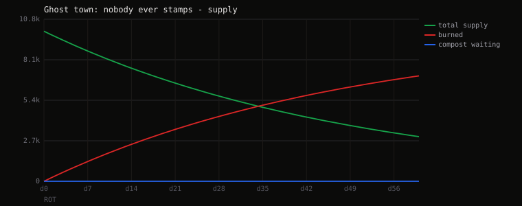
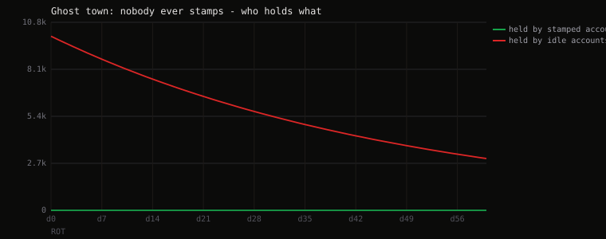
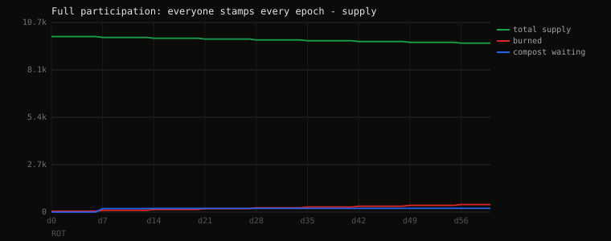
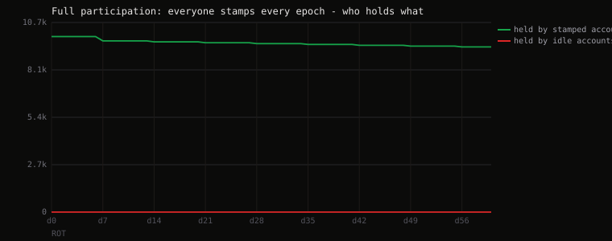
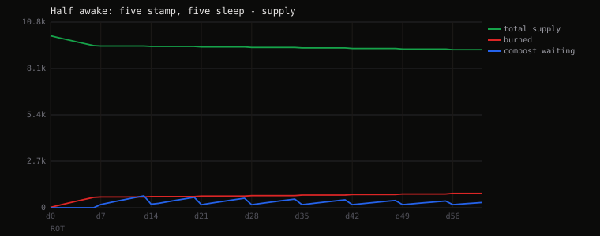
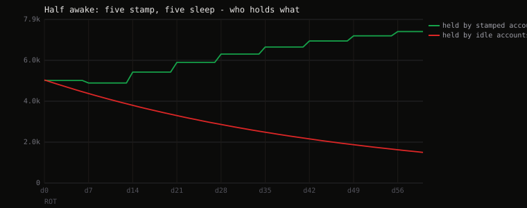
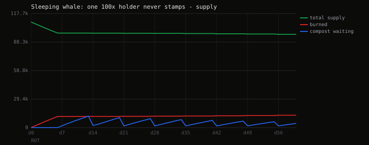
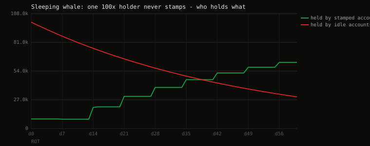
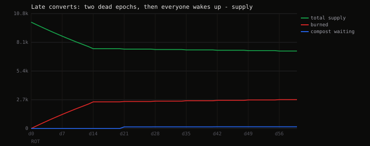
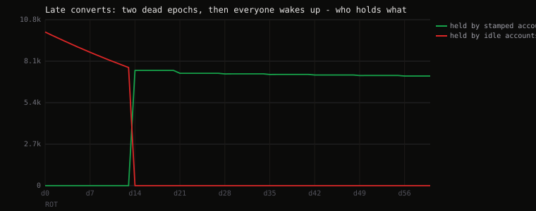

# Sixty days of $ROT

Generated by `python sim/simulate.py`. Every number here comes from the
same arithmetic the contract runs - `sim/simulate.py` mirrors `src/math.rs`
and the shared vectors in `sim/vectors.json` are asserted by both
`cargo test` and the simulation, so the two cannot drift apart silently.

Parameters: **2% rot per day**, **7-day stamp**, **0.5% stamp cost**, **7-day epochs**, 10 holders, 60 days, a rational poker settling every idle account once a day.

## Summary

Each group is measured against **its own** starting balance, because in
the whale run the two groups do not start level.

| scenario | supply after 60d | burned | a stamper's balance | a sleeper's balance |
| --- | --- | --- | --- | --- |
| Ghost town: nobody ever stamps | -70.24% | 7,024 ROT | no one | 1,000 to 298 ROT (-70.2%) |
| Full participation: everyone stamps every epoch | -3.79% | 427 ROT | 1,000 to 938 ROT (-6.2%) | no one |
| Half awake: five stamp, five sleep | -8.09% | 832 ROT | 1,000 to 1,476 ROT (+47.6%) | 1,000 to 298 ROT (-70.2%) |
| Sleeping whale: one 100x holder never stamps | -11.66% | 12,747 ROT | 1,000 to 6,909 ROT (+590.9%) | 100,000 to 29,755 ROT (-70.2%) |
| Late converts: two dead epochs, then everyone wakes up | -27.15% | 2,715 ROT | 1,000 to 714 ROT (-28.6%) | no one |

## Scenario by scenario

### Ghost town: nobody ever stamps

Rot has nobody to pay, so every rotted token burns. This is the scenario that kills most token designs; here it just shrinks supply.

- Supply: 10,000 to 2,976 ROT (-70.24%)
- Burned over the run: 7,024 ROT
- 0 stampers: 0 to 0 ROT (+0.0%)
- 10 sleepers: 1,000 to 298 ROT (-70.2%)
- Longest streak reached: 0 epochs

### Full participation: everyone stamps every epoch

No rot at all, because nobody is ever unshielded. The only supply change is the stamp cost, which burns. $ROT becomes a plain deflationary token.

- Supply: 9,950 to 9,573 ROT (-3.79%)
- Burned over the run: 427 ROT
- 10 stampers: 1,000 to 938 ROT (-6.2%)
- 0 sleepers: 0 to 0 ROT (+0.0%)
- Longest streak reached: 9 epochs

### Half awake: five stamp, five sleep

The intended steady state. The sleepers fund the stampers and the gap between the two groups widens every epoch.

- Supply: 9,975 to 9,168 ROT (-8.09%)
- Burned over the run: 832 ROT
- 5 stampers: 1,000 to 1,476 ROT (+47.6%)
- 5 sleepers: 1,000 to 298 ROT (-70.2%)
- Longest streak reached: 9 epochs

### Sleeping whale: one 100x holder never stamps

A large passive holder is the best thing that can happen to the active ones. The whale's rot is the crowd's income.

- Supply: 108,955 to 96,253 ROT (-11.66%)
- Burned over the run: 12,747 ROT
- 9 stampers: 1,000 to 6,909 ROT (+590.9%)
- 1 sleepers: 100,000 to 29,755 ROT (-70.2%)
- Longest streak reached: 9 epochs

### Late converts: two dead epochs, then everyone wakes up

Burn-heavy at the start because there is nobody to pay, then the supply flattens as participation arrives.

- Supply: 10,000 to 7,285 ROT (-27.15%)
- Burned over the run: 2,715 ROT
- 10 stampers: 1,000 to 714 ROT (-28.6%)
- 0 sleepers: 0 to 0 ROT (+0.0%)
- Longest streak reached: 7 epochs

## What the numbers decided

The parameters were not picked for vibes; these runs chose them.

- **2% a day** is the smallest rate that produces a visible gap between
  stampers and sleepers inside one 60-day run. At 0.5% a day the two
  groups are still within a few percent of each other after two months,
  which makes the mechanic pointless. At 5% a day a holder who misses a
  single epoch loses a third of their balance, which is a punishment,
  not a game.
- **A 7-day stamp against 7-day epochs** is what makes the shield and the
  earning window line up: stamp once a week and you are always shielded
  and always earning. Miss one and you are neither.
- **0.5% to stamp** is the largest cost that still leaves stamping clearly
  profitable in the half-awake case, which is the realistic one. It is the
  only unconditional sink in the design.
- **Earning starts next epoch** so the weight of a running epoch is fixed
  before any compost lands in it. Without that, the winning strategy is
  to watch the heap grow and stamp at the end, and the mechanic collapses
  into a race.

The ghost-town run is the one worth reading twice: with nobody stamping,
nothing breaks and nobody is owed anything. The rot simply burns and the
supply falls. $ROT has no state in which it needs rescuing.
